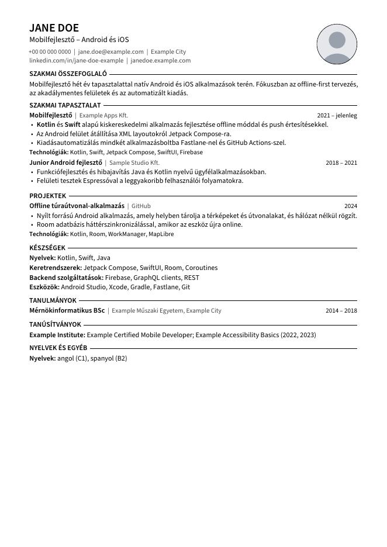

# yaml-latex-cv-generator

[English](README.md) | Magyar

Kétnyelvű (angol, magyar) önéletrajz- és motivációslevél-generátor. Minden szöveg YAML fájlokban van, a design egy LaTeX-osztályban és Jinja2 sablonokban. Egy parancs minden CV-változatot és levelet PDF-be generál; a jelentkezésenkénti fájlok a címet, az összefoglalót és a levelet igazítják, a tényadatokhoz nem nyúlnak.

A repó kitalált mintaadatokkal (Jane Doe) és az ezekből generált PDF-ekkel érkezik.



## Funkciók

- **Egy forrás:** minden CV-tétel egyszer szerepel, a két nyelv egymás mellett (`{en: ..., hu: ...}`).
- **Azonnali fordítási hiba:** a hiányzó vagy hibás nyelvi pár a helyével együtt (`cv.experience[0].role`) megállítja a buildet, nem keletkezik üres sor.
- **Variánsok:** két CV-változat (`developer`, `general`) ugyanabból a tartalomból, variánsfüggő értékekkel (`{"@developer": ..., "@general": ...}`) és tételcímkékkel.
- **Jelentkezésenkénti felülírás:** a jelentkezésfájl csak engedélyezett kulcsokat írhat felül (cím, összefoglaló, szekciósorrend, elrejtett tételek, skill-sorrend, levél). Tényadat (munkahely, dátum) nem írható felül.
- **Biztonságos LaTeX-kimenet:** Jinja2 LaTeX-barát delimiterekkel (`\VAR{}`, `\BLOCK{}`); minden érték automatikusan escape-elődik, a `**szöveg**` félkövér lesz.
- **Reprodukálható PDF:** a rögzített `SOURCE_DATE_EPOCH` miatt azonos tartalomból bájtra azonos PDF készül, így a commitolt kimenet csak tartalmi változáskor módosul.
- **Build-ellenőrzések:** oldalszám (CV: 1 oldal), levél szószáma (angol 250-400, magyar 180-320), korai hiba hiányzó képfájlnál.
- **ATS-barát elrendezés:** egy hasáb, ikonfontok nélkül, kikapcsolt ligatúrák, kontaktadatok sima szövegként.

## Kimenetek (`dist/`)

| Fájl                                           | Tartalom                                 |
| ---------------------------------------------- | ---------------------------------------- |
| `cv_developer_{en,hu}.pdf`                     | Developer CV                             |
| `cv_general_{en,hu}.pdf`                       | Általános CV (nem fejlesztői pozíciók)   |
| `cover_letter_{developer,general}_{en,hu}.pdf` | Általános (fallback) motivációs levelek  |
| `applications/<név>/`                          | Jelentkezés-specifikus CV és levél       |

## Követelmények

- Python 3.14+
- TeX Live: `pdflatex`, `latexmk`, valamint a `extsizes`, `sourcesanspro`, `microtype`, `cmap`, `tikz`, `enumitem` csomagok
- `pdfinfo` és `pdftoppm` (poppler-utils)

Ubuntun: `sudo apt install texlive-latex-extra texlive-fonts-extra latexmk poppler-utils` (a `texlive-latex-extra` behúzza a `texlive-latex-recommended` és a `texlive-pictures` csomagot).

## Gyors indítás

```bash
make venv     # egyszer: .venv jinja2, pyyaml, pytest, ruff csomagokkal
make all      # 4 CV és 4 levél a dist/ mappába
```

## Parancsok

```bash
make cv VARIANT=general LNG=hu              # egy CV
make letter VARIANT=developer LNG=en        # egy levél
make app APP=applications/_example.yaml     # egy jelentkezés
make cv PHOTO=0                             # fotó nélkül (PHOTO=1: fotóval)
make test                                   # pytest
make lint                                   # ruff
make preview                                # README-előnézetek a docs/ mappába
make clean                                  # build/ törlése
```

A `tests/test_context.py` a mintatartalmat ellenőrzi; saját tartalomnál ezt is igazítsd.

## Tartalomformátum

```yaml
# content/cv.yaml
experience:
  - id: example-apps                 # hivatkozás: hide / skills_order
    tags: [developer, general]       # mely variánsokban jelenik meg
    period: {en: 2021 – present, hu: 2021 – jelenleg}
    role: {en: Mobile Developer, hu: Mobilfejlesztő}
    bullets:
      "@developer":                  # variánsfüggő érték
        - en: Development of a **Kotlin** app.
          hu: '**Kotlin** alkalmazás fejlesztése.'
```

- A vesszőt tartalmazó YAML-értéket idézőjelbe kell tenni, különben a `{en: a, b, hu: c}` csendben extra kulcsot kap (ezt a build jelzi).
- Képek: `assets/avatar.jpg` (vagy `photo_file` a `content/profile.yaml`-ban); az opcionális `signature_file` aláírásképet tesz a levélbe.
- A mintalevelek rögzített `date` értéket használnak a `content/cover_letter.yaml`-ban, hogy a commitolt kimenet reprodukálható legyen. Saját használatnál töröld, így a levél a build dátumát kapja, vagy add meg jelentkezésenként a `letter.date` mezőben.

## Új jelentkezés

1. `cp applications/_example.yaml applications/2026-01-15-ceg-pozicio.yaml`
2. `extends`, `langs`, `title`, `summary`, `hide`, `skills_order` és `letter` beállítása.
3. `make app APP=applications/2026-01-15-ceg-pozicio.yaml`

## Szerkezet

```text
content/        profil, feliratok, CV-tételek, motivációs levél (YAML)
variants/       variánsonként cím, összefoglaló, szekciósorrend, kimeneti név
applications/   jelentkezésenkénti felülírás (minta: _example.yaml)
templates/      developercv.cls, header.tex.j2, cv.tex.j2, cover_letter.tex.j2
assets/         képek (helyőrző avatar)
build.py        YAML -> Jinja2 -> LaTeX -> PDF, ellenőrzésekkel
tests/          pytest tesztek (LaTeX nélkül futnak)
dist/           generált minta-PDF-ek
```

## Ismert korlátok

- A nyelvek (`en`, `hu`) és a variánsok (`developer`, `general`) a `build.py`-ban rögzítettek.
- A szekciók köre a `templates/cv.tex.j2` szerint rögzített.
- A PDF-buildhez helyi TeX Live kell; CI-build még nincs.

## Licenc

MIT, lásd [LICENSE](LICENSE). A LaTeX-osztály a LaTeXTemplates.com [Developer CV](https://www.latextemplates.com/template/developer-cv) sablonján alapul (MIT).
