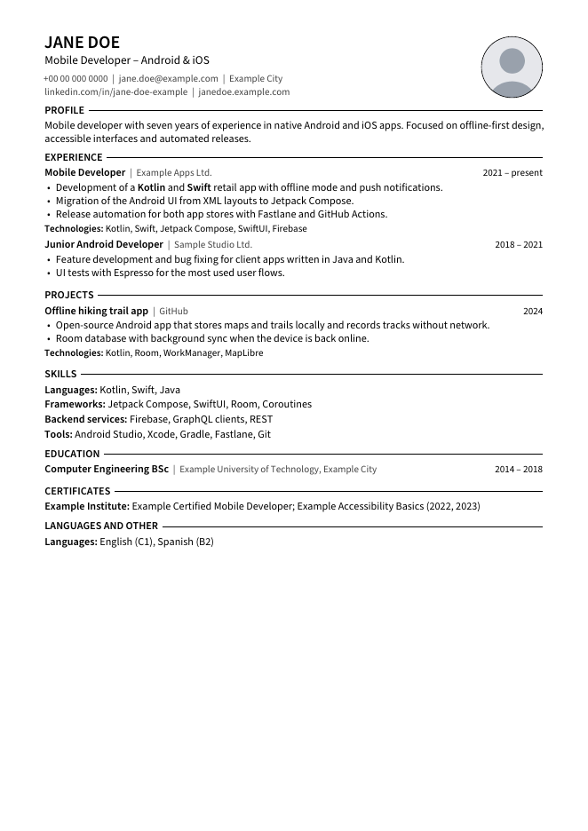

# yaml-latex-cv-generator

English | [Magyar](README.hu.md)

Bilingual (English, Hungarian) CV and cover letter generator. All text lives in YAML files, the design in one LaTeX class with Jinja2 templates. One command builds every CV variant and cover letter as a PDF; per-application files tailor the title, summary and letter without touching the facts.

The repository ships with fictional sample data (Jane Doe) and the PDFs generated from it.



## Features

- **Single source:** every CV item is written once, with both languages side by side (`{en: ..., hu: ...}`).
- **Fail-fast translations:** a missing or malformed language pair stops the build with its location (`cv.experience[0].role`) instead of producing an empty line.
- **Variants:** two CV variants (`developer`, `general`) from the same content, using variant-dependent values (`{"@developer": ..., "@general": ...}`) and item tags.
- **Per-application overrides:** an application file may change only whitelisted keys (title, summary, section order, hidden items, skill order, letter). Facts such as employers and dates cannot be overridden.
- **Safe LaTeX output:** Jinja2 with LaTeX-friendly delimiters (`\VAR{}`, `\BLOCK{}`); every value is escaped automatically, and `**text**` becomes bold.
- **Reproducible PDFs:** a fixed `SOURCE_DATE_EPOCH` makes the same content produce byte-identical PDFs, so committed output changes only when the content does.
- **Build checks:** page count (CV target: 1 page) and letter word count (en 250-400, hu 180-320), plus early errors for missing image files.
- **ATS-friendly layout:** single column, no icon fonts, ligatures disabled, contact details as plain text.

## Outputs (`dist/`)

| File                                           | Content                            |
| ---------------------------------------------- | ---------------------------------- |
| `cv_developer_{en,hu}.pdf`                     | Developer CV                       |
| `cv_general_{en,hu}.pdf`                       | General CV (non-development roles) |
| `cover_letter_{developer,general}_{en,hu}.pdf` | Fallback cover letters             |
| `applications/<name>/`                         | Application-specific CV and letter |

## Requirements

- Python 3.10+
- TeX Live with `pdflatex`, `latexmk` and the packages `extsizes`, `sourcesanspro`, `microtype`, `cmap`, `tikz`, `enumitem`
- `pdfinfo` and `pdftoppm` (poppler-utils)

On Ubuntu: `sudo apt install texlive-latex-extra texlive-fonts-extra latexmk poppler-utils` (`texlive-latex-extra` pulls in `texlive-latex-recommended` and `texlive-pictures`).

## Quick start

```bash
make venv     # once: .venv with jinja2, pyyaml, pytest, ruff
make all      # 4 CVs and 4 cover letters into dist/
```

## Commands

```bash
make cv VARIANT=general LNG=hu              # one CV
make letter VARIANT=developer LNG=en        # one letter
make app APP=applications/_example.yaml     # one application
make cv PHOTO=0                             # without photo (PHOTO=1: with photo)
make test                                   # pytest
make lint                                   # ruff
make preview                                # README preview images into docs/
make clean                                  # remove build/
```

`tests/test_context.py` checks the sample content; adjust it when you replace the content with your own.

## Content format

```yaml
# content/cv.yaml
experience:
  - id: example-apps                 # referenced by hide / skills_order
    tags: [developer, general]       # variants that show this item
    period: {en: 2021 – present, hu: 2021 – jelenleg}
    role: {en: Mobile Developer, hu: Mobilfejlesztő}
    bullets:
      "@developer":                  # variant-dependent value
        - en: Development of a **Kotlin** app.
          hu: '**Kotlin** alkalmazás fejlesztése.'
```

- Quote any YAML value that contains a comma; otherwise `{en: a, b, hu: c}` silently gets an extra key (the build reports it).
- Images: `assets/avatar.jpg` (or `photo_file` in `content/profile.yaml`); an optional `signature_file` adds a signature image to the letter.
- The sample letters use a fixed `date` in `content/cover_letter.yaml` to keep the committed output reproducible. Remove it for real use, so letters get the build date, or set `letter.date` per application.

## New application

1. `cp applications/_example.yaml applications/2026-01-15-company-position.yaml`
2. Set `extends`, `langs`, `title`, `summary`, `hide`, `skills_order` and `letter`.
3. `make app APP=applications/2026-01-15-company-position.yaml`

## Project structure

```text
content/        profile, labels, CV items, cover letter (YAML)
variants/       per-variant title, summary, section order, output name
applications/   per-application overrides (sample: _example.yaml)
templates/      developercv.cls, header.tex.j2, cv.tex.j2, cover_letter.tex.j2
assets/         images (placeholder avatar)
build.py        YAML -> Jinja2 -> LaTeX -> PDF, with checks
tests/          pytest suite (no LaTeX needed)
dist/           generated sample PDFs
```

## Known limitations

- Languages (`en`, `hu`) and variants (`developer`, `general`) are fixed in `build.py`.
- The section set is fixed by `templates/cv.tex.j2`.
- The PDF build needs a local TeX Live installation; there is no CI build yet.

## License

MIT, see [LICENSE](LICENSE). The LaTeX class is based on the [Developer CV](https://www.latextemplates.com/template/developer-cv) template from LaTeXTemplates.com (MIT).
